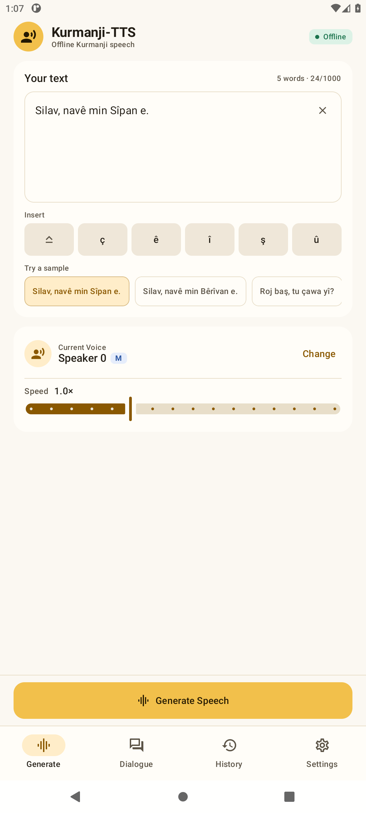
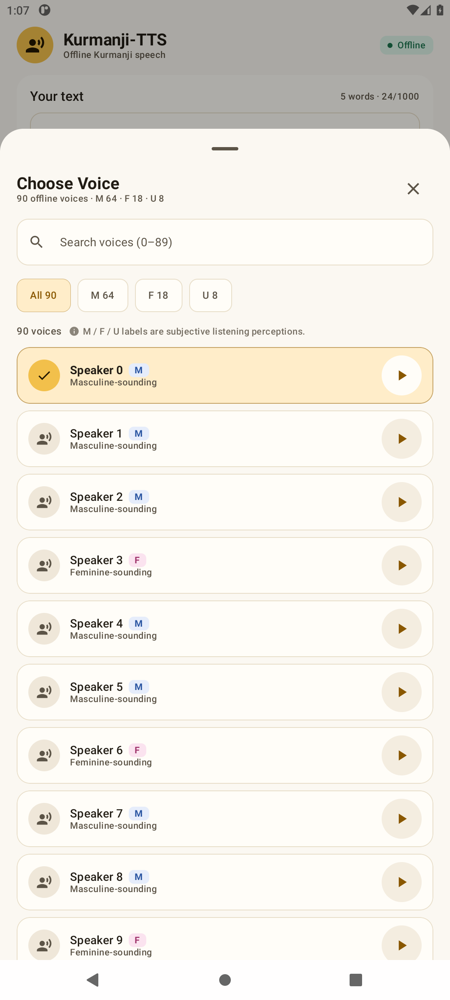
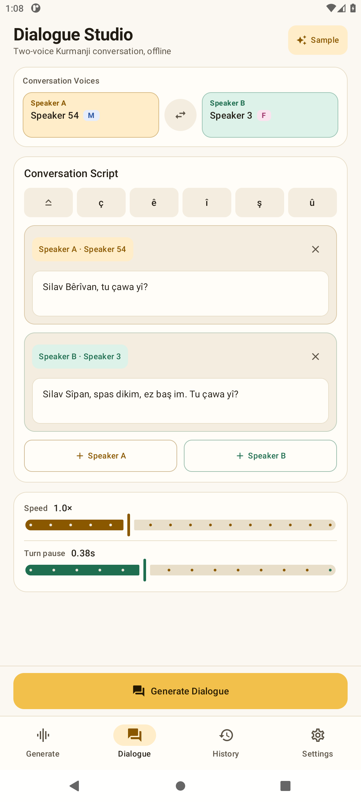

# Kurmanji-TTS — Android downloads

**Offline Kurmanji (Northern Kurdish) text-to-speech for Android.** 90 neural voices, a two-voice dialogue studio and a system-wide `TextToSpeechService` — all on the device, with no `INTERNET` permission, no accounts and no telemetry.

Created by **Sipano** ([@sipan0o](https://www.instagram.com/sipan0o)).

## Download

**[Open the download page →](https://kban19.github.io/kurmanji-tts-android/)** — it detects the visitor's CPU and links to the right APK, and lists every build with its SHA-256 hash.

All builds are attached to the [v1.0.0 release](https://github.com/kban19/kurmanji-tts-android/releases/tag/v1.0.0):

| Build | File | Size |
|---|---|---|
| arm64-v8a (most phones) | `Kurmanji-TTS-v1.0.0-arm64-v8a.apk` | 107 MB |
| armeabi-v7a (older 32-bit phones) | `Kurmanji-TTS-v1.0.0-armeabi-v7a.apk` | 98 MB |
| x86_64 (emulators) | `Kurmanji-TTS-v1.0.0-x86_64.apk` | 111 MB |
| x86 (older emulators) | `Kurmanji-TTS-v1.0.0-x86.apk` | 112 MB |
| Universal (any device) | `Kurmanji-TTS-v1.0.0.apk` | 197 MB |

Every build is signed with the same certificate (SHA-256 `505196dbb4971dfa9c7e571db0b6efdb3c52467453c4f4990dfa399384f03483`), so they update each other without uninstalling. If you are unsure which one to take, use **Universal**.

Verify a download with `sha256sum <file>` (Linux/macOS) or `certutil -hashfile <file> SHA256` (Windows) and compare against [SHA256SUMS.txt](https://github.com/kban19/kurmanji-tts-android/releases/download/v1.0.0/SHA256SUMS.txt).

## Install

1. Download the APK on the phone and open it.
2. Allow installation from this source when Android asks.
3. Open **Kurmanji-TTS → Settings → On-device Model → Load model** once, then type Kurmanji text and press **Generate Speech**.

Requires Android 7.0 (API 24) or newer. The 90-speaker model is bundled in the APK, so nothing is fetched later.

  
  
  

## Project

Documentation and issue tracker: [kbanana10/kurmanjiTTS](https://github.com/kbanana10/kurmanjiTTS).

Licensing: [LICENSE](LICENSE) · third-party components: [THIRD_PARTY_NOTICES.md](THIRD_PARTY_NOTICES.md). Proprietary software © 2026 Sipano. Free to download and use.
